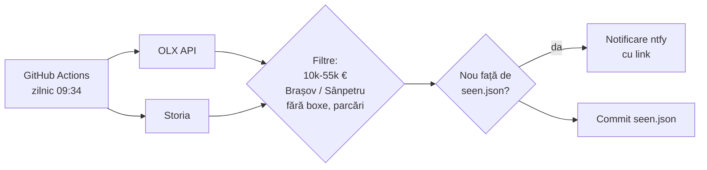

# Alerta garsoniere Brașov / Sânpetru (ntfy)

Verifică zilnic, la **09:34 ora României**, garsonierele de vânzare până în **55.000 €** din Brașov și Sânpetru și trimite o notificare ntfy pentru fiecare anunț nou, cu link direct.

## Abonare la notificări

1. Instalează aplicația **ntfy** (Android / iOS).
2. Apasă **+** și abonează-te la topicul: `garsoniere-bv-9e88aef5` (server: ntfy.sh).
3. Atinge o notificare ca să deschizi anunțul.

Titlul notificării: `suprafață · preț · zonă` (ex. `32 mp · 54.999€ · Brasov`).

## Surse

| Site | Status | Cum |
|---|---|---|
| Storia | funcționează | pagina de rezultate (cele mai noi) |
| OLX | funcționează | API-ul public OLX, categoria garsoniere |
| Imobiliare.ro | blocat | protecție anti-bot (DataDome) pentru serverele GitHub |

Majoritatea anunțurilor de pe Imobiliare apar și pe OLX/Storia (aceleași agenții).

## Cum funcționează

- `seen.json` ține minte anunțurile deja trimise; același anunț postat pe OLX și Storia se trimite o singură dată.
- Prima rulare trimite un singur rezumat (cele mai mari 5 garsoniere existente), apoi doar anunțurile noi.
- Dacă nicio sursă nu răspunde, primești o notificare de avertizare.

## Setări utile

- **Buget / preț minim:** `MAX_EUR` și `MIN_EUR` din `scraper.py`.
- **Topic privat:** repo-ul e public, deci topicul se vede. Creează un secret `NTFY_TOPIC` (Settings > Secrets and variables > Actions) cu alt nume și abonează-te la el.
- **Test manual:** Actions > Garsoniere noi > Run workflow (bifează *debug* ca să nu trimită notificări).
