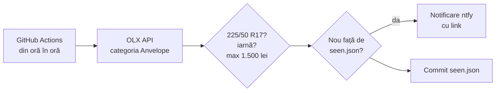

# Alertă anvelope de iarnă 225/50 R17 (ntfy)

Verifică OLX **din oră în oră, între 07:00 și 22:00 ora României**, anunțurile de anvelope de iarnă **225/50 R17** din Brașov și o rază de 50 km. Pentru fiecare anunț nou primești o notificare ntfy cu link direct.

## Abonare la notificări

1. Deschide aplicația **ntfy**.
2. Apasă **+** și abonează-te la topicul `anvelope-bv-7c41d2e9` (server: ntfy.sh).
3. Atinge o notificare ca să deschizi anunțul.

Titlul notificării arată `preț · oraș · DOT · profil (mm)`, de exemplu `425 lei · Brasov · DOT 2024`.

## Ce filtrează

- dimensiunea 225/50 R17 (din filtrele OLX sau din titlu/descriere)
- doar iarnă: exclude vară și all season / mixte
- exclude jante, capace, lanțuri, vulcanizări
- preț maxim 1.500 lei (`MAX_LEI` în `scraper.py`)

## Cum funcționează

- Prima rulare trimite lista cu toate anunțurile potrivite, sortate după preț; apoi doar pe cele noi.
- **Oprire:** după ce cumperi anvelopele, Actions > Anvelope iarna 225/50 R17 > ⋯ > Disable workflow.
- **Test manual:** Actions > Anvelope iarna 225/50 R17 > Run workflow (bifează *debug* ca să nu trimită notificări).
